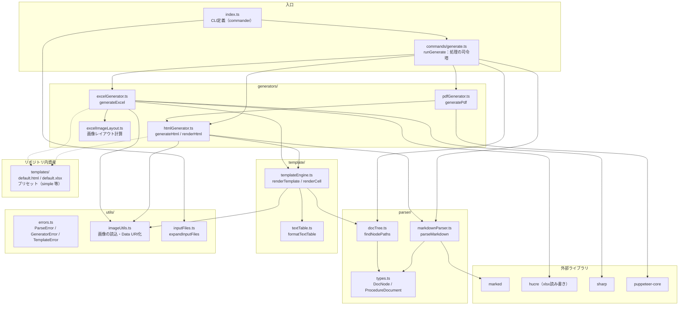
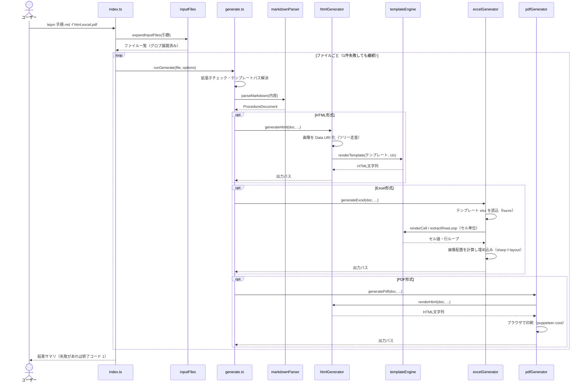
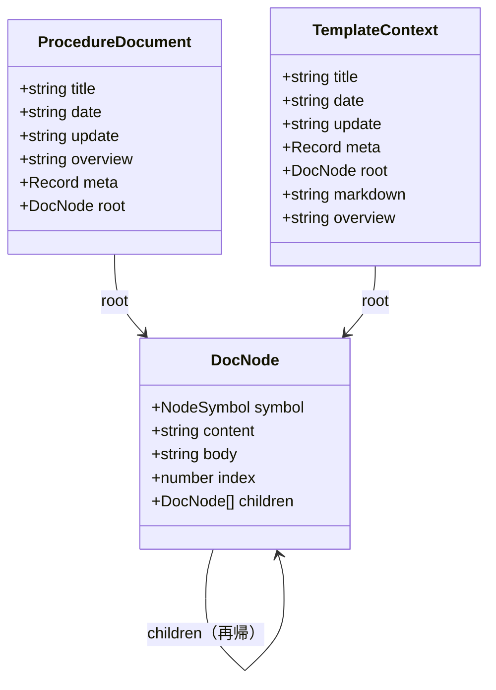
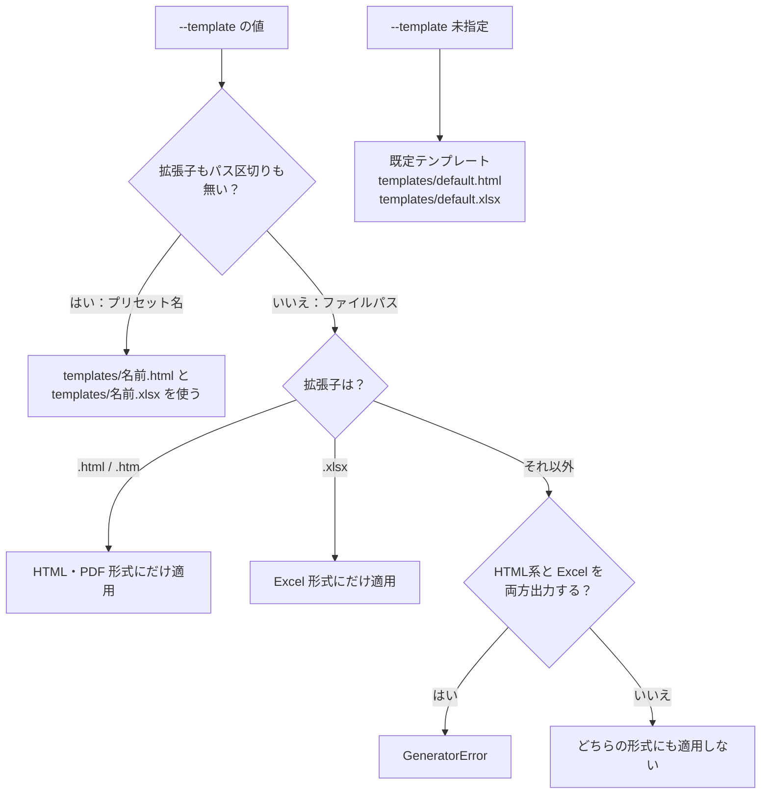

# Tejun.ts アーキテクチャ

Tejun.ts の内部構造の地図。仕様は `spec/`（[spec.md](../spec/spec.md) が索引）、
この文書は「コードがどう組み上がっているか」を扱う。
モジュール構成や呼び出しの流れを変えたら、この文書も合わせて更新すること。

最終確認: 2026-11-26（`src/` の実装を実地に読んで作成）

## 1. 全体像

Markdown の手順書を、パースして中間表現（文書ツリー）に変換し、
形式ごとのジェネレータがテンプレートと組み合わせて HTML / Excel / PDF を出す、
という一方向のパイプライン。

```text
Markdown ──parse──▶ ProcedureDocument（DocNodeツリー）
                        │
            ┌───────────┼────────────┐
            ▼           ▼            ▼
        HTML生成     Excel生成     PDF生成
     (テンプレート   (xlsxテンプ   (HTMLを経由して
      展開＋画像      レートに流し   ブラウザで印刷)
      Data URI化)     込み＋画像配置)
```

中核の設計判断は 2 つ。

- **中間表現は 1 つだけ**: パーサーが作る `DocNode` ツリー（`src/parser/types.ts`）を
  全ジェネレータが共有する。形式ごとの都合はジェネレータ側に閉じ込める。
- **テンプレートエンジンは HTML / Excel 共用**: `{{#each}}` などの構文は共通で、
  Excel ではセル単位の API（`renderCell` など）を別に公開している。

## 2. モジュール構成図



## 3. モジュール一覧

| ファイル | 役割 | 主な公開API |
|---|---|---|
| `src/index.ts` | CLI の入口。引数・オプション定義、複数ファイルのループ、エラー表示と終了コード | （commander のプログラム定義） |
| `src/commands/generate.ts` | 1 ファイル分の変換の司令塔。検証 → パース → 形式ごとにジェネレータを呼ぶ。テンプレートパスの解決と出力ファイル名の決定もここ | `runGenerate` / `parseFormats` / `resolveTemplatePaths` / `resolveOutputBaseName` |
| `src/parser/markdownParser.ts` | Markdown → `ProcedureDocument`。Front Matter 分離、marked のトークン列から見出しスタックでツリーを構築 | `parseMarkdown` / `parseFrontMatter` |
| `src/parser/docTree.ts` | ツリー探索。指定記号の要素を「ルート側からの経路」として列挙する | `findNodePaths` |
| `src/parser/types.ts` | 中間表現の型定義（全モジュールの共通言語） | `DocNode` / `ProcedureDocument` / `TemplateContext` / `NodeSymbol` |
| `src/template/templateEngine.ts` | テンプレート展開。`{{#each}}` / `{{#if}}` / 変数参照の解釈、HTML→テキストセグメント変換（Excel の書式保持用） | `renderTemplate` / `renderCell` / `replaceCellVariables` / `extractRowLoop` / `expandLoopChains` / `stripHtml` |
| `src/template/textTable.ts` | Markdown の表を等幅テキスト表に整形（Excel セル内表示用） | `formatTextTable` |
| `src/generators/htmlGenerator.ts` | HTML 生成。ツリー内の画像を Data URI 化し、テンプレートを展開。PDF からも再利用される | `generateHtml` / `renderHtml` |
| `src/generators/excelGenerator.ts` | Excel 生成。xlsx テンプレートの先頭シートにセル単位で流し込み、行ループ展開と画像配置を行う | `generateExcel` |
| `src/generators/excelImageLayout.ts` | Excel の列幅・行高から画像の配置位置とサイズを計算する純粋計算モジュール | `layoutImages` / `columnWidthPx` / `estimateTextHeightPx` |
| `src/generators/pdfGenerator.ts` | PDF 生成。`renderHtml` の結果を Edge / Chrome で印刷する | `generatePdf` / `findBrowser` / `browserCandidates` |
| `src/utils/errors.ts` | エラー型 3 種（後述） | `ParseError` / `GeneratorError` / `TemplateError` |
| `src/utils/imageUtils.ts` | 画像まわりの共通処理。ローカル画像の Data URI 化、`` 抽出、拡大表示ラップ、パス解決 | `embedImagesInHtml` / `extractImageSrcs` / `wrapImagesForZoom` / `resolveImagePath` |
| `src/utils/inputFiles.ts` | CLI 引数のファイル一覧を展開（グロブ対応） | `expandInputFiles` / `isGlobPattern` |

テストは各モジュールの隣に `*.test.ts` として同居する（例: `src/template/templateEngine.test.ts`）。

## 4. 実行シーケンス（generate）



## 5. データモデル



`DocNode.symbol` が要素の種類を表す。見出しは `#`〜`######`、引用は `>`、
箇条書きは `-`、番号付きリストは `1.`、コードブロックは ` ``` `、文書全体は `root`。

パース時の規則（`markdownParser.ts`）:

- 見出しは「次に同じか上位の見出しが現れるまで」の内容を子に持つ（スタックで管理）。
- 見出し直下で、最初の引用（`>`）より前に書かれた本文は、その見出しの `body` になる。
- 最初の H2 以降の見出しより前の内容は文書の `overview` になる。
- タイトルは Front Matter の `title` 優先、なければ最初の H1。どちらも無ければ `ParseError`。
- `index` は「同じ親・同じ種類の中での連番」。テンプレートの番号表示に使う。

## 6. テンプレートの解決

`--template` の値は `generate.ts` の `resolveTemplatePaths` が解釈する。



テンプレートエンジン（`templateEngine.ts`）の要点:

- 構文の仕様は [spec/template-syntax.md](../spec/template-syntax.md)、実例は
  [spec/template_reference.md](../spec/template_reference.md) を参照。
- `renderTemplate`（HTML 用）は `${title}` / `${date}` / `${update}` /
  `${markdown}` / `${overview}` の置換も行う。Excel 用のセル API には `${...}` 置換は無い。
- Excel ではセル内の HTML を `TextSegment`（テキスト＋書式の断片）に分解してから
  セル値にするため、太字などのインライン書式が xlsx 側に引き継がれる。
- 行ループは「テンプレート側の行」を `extractRowLoop` で抜き出し、
  `expandLoopChains` で文書ツリー側の経路と対応付けて行を増減する。

## 7. 形式ごとの生成の要点

### HTML（`htmlGenerator.ts`）

1. ツリーを再帰的にたどり、要素の HTML 内の `` を Data URI に置換し、
   クリック拡大用に `<label>` で囲む（単一ファイルで配れるようにするため）。
2. テンプレートの `${markdown}` 用に、Front Matter を除いた Markdown 全文も
   marked で HTML 化して画像処理を通す。
3. `renderTemplate` でテンプレートを展開し、ファイルに書き出す。

### Excel（`excelGenerator.ts`）

1. テンプレート xlsx を hucre で読み、先頭シートだけを使う。
2. セルを走査して `renderCell` で変数・制御タグを展開。行ループがあれば行を挿入・削除して繰り返す。
3. 画像は sharp で実サイズを取り、`excelImageLayout` で列幅・行高から配置を計算して埋め込む。
4. `writeXlsx` で書き出す（画面設定 bookViews / sheetViews を必ず含める。
   無いと Windows の表示スケール 150% 環境で表示が崩れるため）。

### PDF（`pdfGenerator.ts`）

1. `renderHtml` で HTML を得る（HTML 形式を出力しない場合でも内部で生成する）。
2. ブラウザは `--browser` 指定か、OS ごとの候補パスから Edge / Chrome を探す。
3. puppeteer-core で JavaScript 無効のまま読み込み、A4・余白 15mm・
   フッターにページ番号・見出しからしおり（outline）を付けて印刷する。

## 8. エラー設計

| エラー型 | どこから出るか | 例 |
|---|---|---|
| `ParseError` | パーサー、CLI 引数の解釈 | タイトルが無い Markdown、`--format` の値が不正 |
| `TemplateError` | テンプレートエンジン | `{{#each}}` の閉じタグ不一致 |
| `GeneratorError` | ジェネレータ、テンプレート解決 | テンプレートが見つからない、ブラウザが見つからない |

`index.ts` の `reportError` がこの 3 種は「❌ エラー名: メッセージ」だけを出し、
それ以外は予期しないエラーとして詳細を出す。
複数ファイル指定時は 1 件失敗しても残りを変換し続け、最後に失敗一覧を出して終了コード 1 を返す。

## 9. 拡張のしかた

- **出力形式を増やす**: `src/generators/` に `generateXxx(doc, inputFilePath, outputDir, templatePath?, outputBaseName?)` を実装し、
  `generate.ts` の `OutputFormat` と `runGenerate` の分岐、`index.ts` の `--format` 説明に足す。
- **テンプレート記号を増やす**: パーサー（`types.ts` の `NodeSymbol` と `markdownParser.ts` の振り分け）と
  テンプレートエンジンの両方が関係する。仕様側は `spec/template-syntax.md` を先に直す。
- **プリセットを増やす**: `templates/` に `<名前>.html` / `<名前>.xlsx` を置くだけで `--template <名前>` で選べる。
